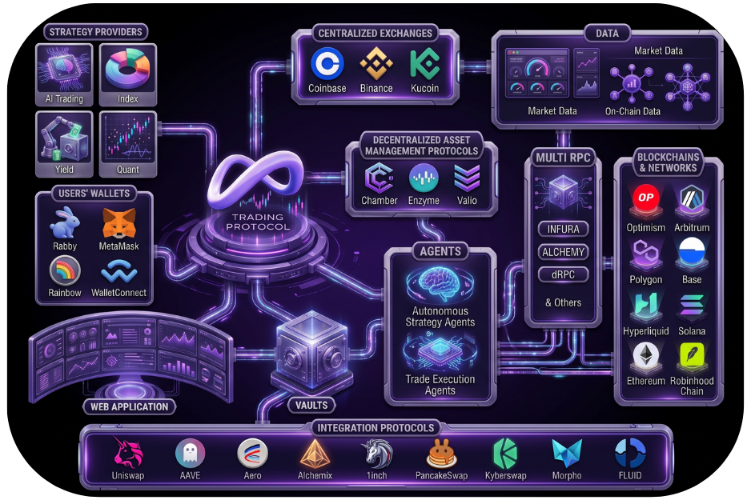

<p align="center">
  
</p>

<h1 align="center">Infinite Trading Protocol</h1>

<p align="center">
  On-chain vaults, auto-compounders and automation for DeFi liquidity.<br/>
  <a href="https://infinitetrading.io">infinitetrading.io</a> ·
  <a href="gitbook/README.md">Documentation</a> ·
  <a href="SECURITY.md">Security</a>
</p>

---

Infinite Trading Protocol (ITP) builds non-custodial vaults that put liquidity to
work automatically: auto-compounding LP vaults on Aero, Velodrome and Uniswap,
a Morpho-based USD yield vault, managed trading vaults and the ITP staking and
membership contracts. This repository contains the Solidity sources, tests,
deployment records, security reviews, an admin console and integration examples.

## Repository layout

| Path | Contents |
|---|---|
| [`contracts/`](contracts/README.md) | Foundry project: Solidity sources, tests, deployment scripts |
| [`contracts_audits/`](contracts_audits) | Security review reports (PDF) |
| [`docs/`](docs/README.md) | Technical documentation, integration guides and internal reviews |
| [`gitbook/`](gitbook/README.md) | User documentation (vaults, staking, API, roadmap) |
| [`dashboard/factory-admin/`](dashboard/factory-admin/README.md) | Static admin console for factories, vaults, deployments and Safe batches |
| [`constants/`](constants) | Canonical address registry ([`contracts.ts`](constants/contracts.ts)) and token list |
| [`src/`](src/README.md) | API and data integration examples in R, Python and TypeScript |
| [`logos/`](logos), [`images/`](images) | Brand assets |

## Products

| Product | Contracts | Chains | Status |
|---|---|---|---|
| Aero auto-compounders | [`contracts/src/aero/`](contracts/src/aero/README.md) · [design](docs/aero-automation.md) | Optimism, Base (v2); Ethereum, Robinhood Chain (v1) | Live |
| Velodrome auto-compounders | [`InfiniteVaultStrategy`](contracts/src/velodrome/InfiniteVaultStrategy.sol) | Optimism | Live |
| Uniswap V3 / V4 auto-compounders | [`UniV3AutoCompounder`](contracts/src/UniV3AutoCompounder.sol), [`UniV4AutoCompounder`](contracts/src/UniV4AutoCompounder.sol) · [integration](docs/frontend-integration.md) · [upgrades](contracts/UPGRADE.md) | Base | V3 live, V4 not yet deployed |
| USD yield vault | [`contracts/src/yield/`](contracts/src/yield) (Morpho Vault V2) | Base | Pre-deployment |
| Managed vaults | [`ManagedVault`](contracts/src/ManagedVault.sol), [`ManagedVaultFactory`](contracts/src/ManagedVaultFactory.sol), [`TraderRouter`](contracts/src/TraderRouter.sol) | — | Proof of concept, not deployed |
| Infinite Agents memberships | [`AgentSeats`](contracts/src/AgentSeats.sol) · [docs](docs/agent-seats.md) | Optimism | Tested, not deployed |
| stSATO | [`StSATO`](contracts/src/stsato.sol) · [integration](docs/stsato-frontend-integration.md) | Ethereum | Live |

## Quick start

```sh
git clone https://github.com/InfiniteTradingProtocol/infinite-trading-protocol.git
cd infinite-trading-protocol/contracts
npm install
forge test                                   # default profile
FOUNDRY_PROFILE=aero forge test              # Aero auto-compounders
FOUNDRY_PROFILE=yield forge test             # USD yield vault
```

Each module has its own Foundry profile; see [contracts/README.md](contracts/README.md).

## Deployments

Core addresses (full registry: [`constants/contracts.ts`](constants/contracts.ts)):

| Contract | Chain | Address |
|---|---|---|
| ITP token | Optimism | [`0x0a7B751FcDBBAA8BB988B9217ad5Fb5cfe7bf7A0`](https://optimistic.etherscan.io/address/0x0a7B751FcDBBAA8BB988B9217ad5Fb5cfe7bf7A0) |
| DAO Safe (owner and treasury) | Optimism, Base, Ethereum | `0xb5dB6e5a301E595B76F40319896a8dbDc277CEfB` |
| stSATO | Ethereum | [`0xdeE7f7A032326148E65EC3068F1c9b29E26B75b3`](https://etherscan.io/address/0xdeE7f7A032326148E65EC3068F1c9b29E26B75b3) | Live |

Aero v2 auto-compounders (current):

| Contract | Optimism (10) | Base (8453) |
|---|---|---|
| AeroFactoryV2 | `0x337Fe450bCD603B1c637AB0F4C073d926a1aE3Dc` | `0xB60ce95161506EeC22A2D68A784DD21cf78adcA9` |
| AeroTwapOracle | `0x351F1F1aBf8cc65AacD13cAA19bB4639F7C0b5bf` | `0x4751B11220919d8A76Bf3998d85Ecb6524D0Ed82` |
| AeroZapV2 | `0x95E97Def5456d5860a26DD3108A71Dd13b3E3592` | `0xAdF1288917495F806b6014f354638F905B9Ce3fa` |
| Vaults | ITP/wstETH `0x4bd84dD4fF4FfbcD2ee08dB22Ce3b9a2eeB10a58`<br/>ITP/USDC `0x579f6D1646fDEb59B37a4DC880DbB6857004BafD`<br/>ITP/WBTC `0x6E276D140230C6f967ee2c79AEd69C90A24e115D` | AERO/USDC `0xA7e2E4Cb6B4938AAaDE3EbDEDe373205818129fC` |

More records:

- Aero v1 factories (Ethereum, Robinhood Chain) and superseded contracts: [docs/aero-automation.md](docs/aero-automation.md#aero-v1-deployments)
- Aero deployment JSON and Safe batches: [contracts/src/aero/deployments/](contracts/src/aero/deployments)
- Velodrome vaults (6 BeaconProxy vaults on Optimism): section 8 of the [2026-10-30 security review](contracts/src/aero/audits/2026-10-30_Auto-Compounder_Security_Review.md)
- Uniswap V3 auto-compounder proxies and implementations (Base): [`constants/contracts.ts`](constants/contracts.ts), [contracts/UPGRADE.md](contracts/UPGRADE.md)

## Security reviews

| Date | Scope | Report |
|---|---|---|
| 2026-10-30 | Aero v2 and Velodrome `InfiniteVaultStrategy` auto-compounders | [Markdown](contracts/src/aero/audits/2026-10-30_Auto-Compounder_Security_Review.md) · [PDF](contracts/src/aero/audits/2026-10-30_Auto-Compounder_Security_Review.pdf) |
| 2026-10-24 | Aero v1 audit and v2 adversarial review | [PDF](contracts/src/aero/audits/2026-10-24_Aero_v1_v2_UltraCode_Audit.pdf) |
| 2026-10-16 | USD yield vault (internal review) | [Markdown](docs/usd-yield-vault-audit.md) |
| 2026-09-30 | `InfiniteVaultStrategy` v2.1 | [PDF](contracts_audits/InfiniteVaultStrategy_v2.1_Security_Review_2026-09-30.pdf) |
| 2026-05 | `StSATO` | [v1](docs/stsato-audit.md) · [v2](docs/stsato-audit-v2.md) · [report](contracts_audits/stSATO_Audit_Report.pdf) |

Found a vulnerability? Please follow the [security policy](SECURITY.md) and do not
open a public issue.

## Contributing

Issues and pull requests are welcome. Please run the relevant Foundry profile's
tests and `forge fmt --check` before opening a pull request, and keep secrets,
private keys and RPC keys out of commits (`.env` files are git-ignored).

## License

[MIT](LICENSE). Third-party code under `contracts/lib/` keeps its own license.

## Contact

[admin@infinitetrading.io](mailto:admin@infinitetrading.io) ·
Telegram [@infinitetradingprotocol](https://t.me/infinitetradingprotocol) ·
X [@infinitetradepr](https://x.com/infinitetradepr)
