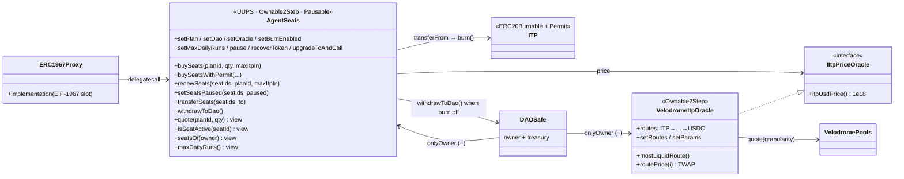
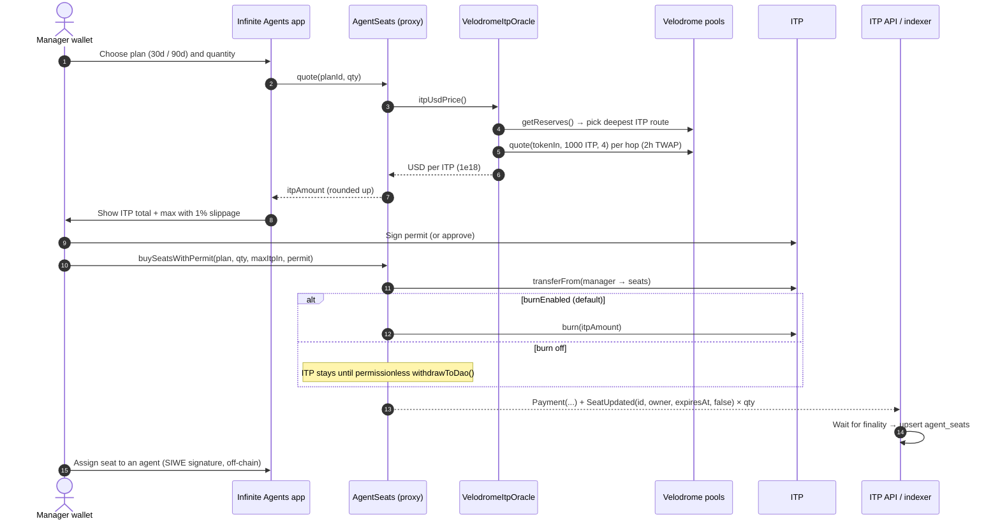
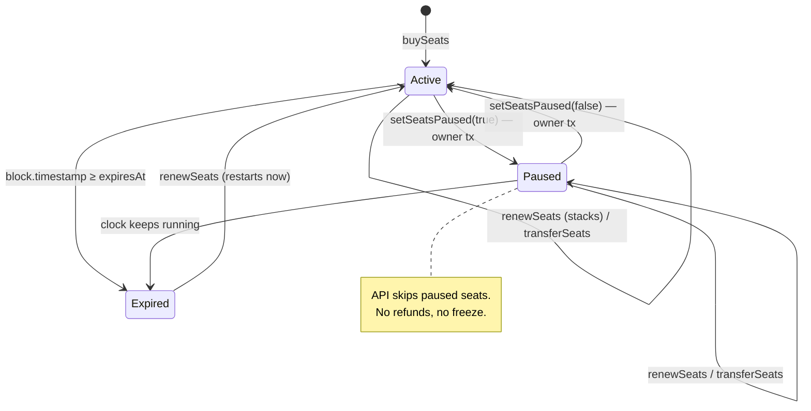
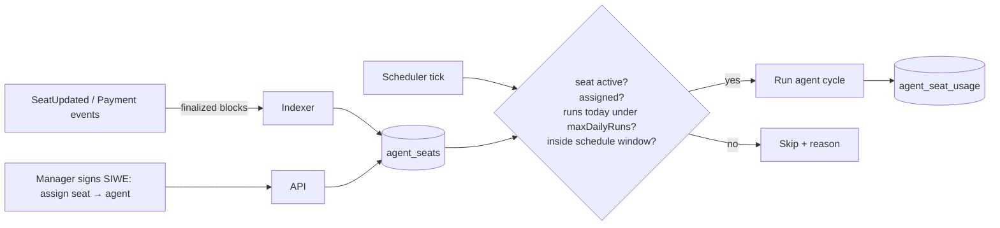

# AgentSeats — Infinite Agents memberships

One **seat** = the right to run **one** Infinite Agent until the seat expires. Managers
buy seats in ITP. The price is fixed in USD and converted at a Velodrome TWAP. ITP is
burned, or sent to the DAO when burning is switched off. The Infinite Trading API
reads seat state and enforces the run limits. **Users never need a recurring
on-chain transaction.**

| | |
|---|---|
| Contracts | `contracts/src/AgentSeats.sol`, `contracts/src/VelodromeItpOracle.sol` |
| Interfaces | `contracts/src/interfaces/IAgentSeats.sol`, `IItpPriceOracle.sol` |
| Network | Optimism (ITP `0x0a7B751FcDBBAA8BB988B9217ad5Fb5cfe7bf7A0`) |
| Owner / DAO | DAO Safe `0xb5dB6e5a301E595B76F40319896a8dbDc277CEfB` (3-of-N) |
| Plans | `1` = 30 days / $19.99 · `2` = 90 days / $49.99 |
| Run cap | `maxDailyRuns()` = 10 runs per seat per UTC day (enforced by the API) |
| Status | Tested (unit, fuzz and fork) and simulated on an Optimism fork. **Not deployed, not audited.** |

## 1. Architecture



`~` marks owner-only functions. The proxy's owner is the DAO Safe. The deployer key
holds no role after deployment.

**Storage layout.** All state lives in one ERC-7201 namespace,
`infinitetrading.storage.AgentSeats`, at slot
`0xdb0913769ce36d75658594fd1260b2c5d5d7706f644d1cc142b23b5f2c41ea00`. Upgrades may
only append fields to `AgentSeatsStorage`.

## 2. Buying seats



The same flow applies to renewals with `renewSeats(ids, plan, maxItpIn)`.
**Anyone** can pay for **any** seat, so a team or a sponsor can top up a manager's
seats. Renewed time stacks on top of the remaining time. An expired seat restarts
from the moment of payment.

## 3. Seat lifecycle



`isSeatActive(id)` returns `owner != 0 && !paused && expiresAt > now`. The API must
apply the same rule.

## 4. Pricing and the oracle

```
itpAmount = ceil(usdCents × 1e16 × 1e18 / itpUsdPrice)
```

The fuzz test checks that the payment always covers the USD price and over-charges
by at most 1 wei.

`VelodromeItpOracle` reads only Velodrome v2 **TWAPs** (`pool.quote(tokenIn, amount, granularity)`),
never spot reserves, so a flash loan cannot move the price.

| Step | Rule |
|---|---|
| Route choice | Among the configured routes, use the one whose first pool holds the most ITP and at least `minItpReserve` (100k ITP). Today that is **ITP/VELO → VELO/USDC**. |
| Freshness | Every hop's `lastObservation()` must be ≤ `maxStaleness` (1 day) old. If trading is quiet, anyone can call `pool.sync()` to write a fresh observation. |
| Sanity | Every other eligible route that can be quoted must agree within `maxDeviationBps` (20%). Stale secondary routes are skipped. |
| Window | `granularity = 4` × 30-minute windows, roughly a 2-hour TWAP. `quoteAmount = 1000 ITP` keeps price impact negligible. |

Live check on an Optimism fork: TWAP $0.006134 per ITP, so a 30-day seat costs
3,258.9 ITP and a 90-day seat costs 8,149.7 ITP.

Routes and parameters are owner-only. To change the price source entirely, the DAO
calls `AgentSeats.setOracle`.

## 5. Roles and rules

| Who | Can |
|---|---|
| Manager (seat owner) | Buy seats; pause or resume its own seats; transfer them to a new wallet |
| Anyone | Renew any seat; call `withdrawToDao()` (funds always go to `dao`) |
| Owner (DAO Safe) | Set plans and prices; switch burn on or off; set `dao` and the oracle; set `maxDailyRuns` (1–96); pause payments; recover non-ITP tokens; upgrade; 2-step ownership transfer |

Rules:

- At most 25 seats per transaction.
- No refunds.
- A global `pause()` blocks only buying and renewing. Managers can still pause and
  transfer their seats.
- Tokens that take a fee on transfer are rejected.
- A permit that someone front-runs only consumes the nonce, so the purchase still
  succeeds through the existing allowance.

## 6. How the API consumes seats



- The indexer upserts `seat_id → owner, expires_at, paused` from `SeatUpdated`. The
  last event always wins.
- `Payment` events are kept for revenue reporting.
- Before every cycle the worker calls `isSeatActive` (or uses cached state younger
  than about 5 minutes), so a seat paused on-chain stops at the next tick.
- Seat assignment is off-chain: one active agent per seat, with a signed message
  from the seat owner. A transferred seat is unassigned automatically.

## 7. Testing and deployment

```bash
cd contracts
FOUNDRY_PROFILE=agent-seats forge test --match-path 'test/AgentSeats*'          # 34 unit/fuzz tests
AGENT_SEATS_FORK=true FOUNDRY_PROFILE=agent-seats \
  forge test --match-path test/AgentSeats.fork.t.sol                           # real ITP + pools
```

Deploy by running `script/DeployAgentSeats.s.sol` (it deploys the oracle, the
implementation and the proxy). The owner and `dao` are set to the DAO Safe in
`initialize`, so no ownership handover is needed.

```bash
DEPLOYER_PRIVATE_KEY=0x... FOUNDRY_PROFILE=agent-seats \
  forge script script/DeployAgentSeats.s.sol --rpc-url optimism --broadcast --verify
```

Rehearse on an anvil fork first (`anvil --fork-url https://mainnet.optimism.io`),
then delete `broadcast/`.

**Before mainnet:**

1. External audit of `AgentSeats` and `VelodromeItpOracle`.
2. Confirm that ITP's `burn(uint256)` and permit work as expected (already
   exercised by the fork tests).
3. Monitor the price and ITP pool depth (alert if the deepest route drops below
   100k ITP).
4. Publish the proxy address to the API config and the frontend.
5. Upgrades go through a DAO Safe transaction (`upgradeToAndCall`). Validate the
   storage layout with `forge inspect AgentSeats storageLayout` before each one.
